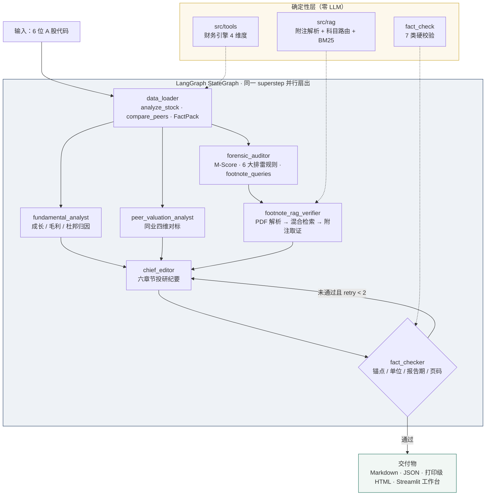

# FinSight-Agent

**面向金融投研与财务尽调的多智能体 A 股财报深度解构与会计排雷系统（Forensic Accounting Agent）。**

输入一个 6 位股票代码，系统在 45 秒内产出：四大维度确定性财务指标 → 杜邦三因子连环替代归因 →
Beneish M-Score + 6 条本土化排雷规则 → **翻年报 PDF 附注为疑点取证（带精确页码）** →
六章节投研纪要 → 确定性防幻觉质检 → 可打印的 HTML / Markdown / JSON 全套交付物。

> 不是"让大模型读财报"，而是**让 Python 算清楚、让大模型讲明白、让规则卡住幻觉**。

`Python 3.10` · `LangGraph` · `DeepSeek` · `Streamlit` · `PyMuPDF` · `零额外付费 Key`

---

## 一、它解决什么问题：普通 ChatGPT 读财报的三大致命伤

| 致命伤 | ChatGPT 直接读财报 | FinSight-Agent 的做法 |
|---|---|---|
| **① 数字不可信** | 让 LLM 口算 ROE、同比、杜邦拆解，长上下文里稍一走神就串行串列；同一份财报问两次答案不同 | **计算与推理严格分离**：所有比率由 Pandas/Numpy 精确计算并冻结为 Pydantic JSON，LLM 只允许"解读已算好的数字"。杜邦恒等式误差实战为 `0.0`，三因子贡献之和与 ROE 实际变动误差 `1e-6` |
| **② 结论不可追溯** | "公司毛利率下滑"——哪一年？哪个科目？年报第几页？无法回答，因此尽调时**不能作为底稿** | **全链路溯源**：每个数字携带 `report_period` + 原始科目 + 数据源接口；每个附注结论携带 **`P.xx` 精确页码 + 原文摘录**，可一键回溯到年报 PDF 原页 |
| **③ 不懂会计，只会念数字** | 看到应收账款增速 100 倍就喊"财务造假"，看不到基数只有 0.0015%；看到货币资金与现金等价物差 747 亿就喊"资金被占用"，不知道那是合并财务公司的列报口径差异 | **CPA 本土化判定逻辑**：重要性原则门槛、非经常性损益**方向**判定（保壳扭亏 vs 一次性支出拖累）、受限资金勾稽与财务公司识别——每条规则都写明"为什么这样判"，并在附注中找证据 |

---

## 二、系统架构



**分层依赖是单向的**（`schemas ← diagnostics ← financial_data ← financial_engine ← peer_comparison
← context_formatter ← fact_check ← nodes ← graph ← tests`），
`src/rag/*` 只被 RAG 节点单向调用，UI 层只读不写、只渲染不算。

---

## 三、四大核心技术与专业壁垒

### ① 确定性财务引擎：杜邦连环替代 + CPA 本土化排雷

**杜邦三因子连环替代（教材标准做法，可完整归因、无残差）**

```
ROE₀ = 净利率₀ × 周转率₀ × 权益乘数₀
R₁ = 净利率₁ × 周转率₀ × 权益乘数₀   → 净利率贡献   = R₁ - ROE₀
R₂ = 净利率₁ × 周转率₁ × 权益乘数₀   → 周转率贡献   = R₂ - R₁
R₃ = 净利率₁ × 周转率₁ × 权益乘数₁   → 权益乘数贡献 = R₃ - R₂
```

茅台 2025 年报实测：ROE 由 38.37% 降至 34.40%（**-3.97pct**），
三因子分别贡献 `-1.28pct（净利率）`、`-2.34pct（周转率）`、`-0.35pct（权益乘数）`，
合计 `-3.97pct` —— 与 ROE 实际变动误差 `1e-6`，可直接作为尽调底稿。

**六条本土化排雷规则**（均非阈值拍脑袋，而是带会计语义的判定）：

| 规则 | 会计逻辑 |
|---|---|
| `Beneish M-Score`（8 变量） | 逐变量给出取值、系数、贡献，明确"哪个变量在推高嫌疑"，金融股自动判不适用 |
| 受限货币资金勾稽 | `货币资金 ≫ 期末现金等价物` → 推算受限比例；若反向（`END_CCE > 货币资金×1.05`）则识别为**合并财务公司列报口径差异**，排除误判 |
| 纸面富贵（应收激增） | 增速差 15pct 只是必要条件，还须过**重要性门槛**（应收/营收 ≥ 1%），否则基数为 0.0015% 的白酒会被冤枉 |
| 非经常性损益 | **先判方向再判幅度**：`归母>0 且 扣非<0` = 保壳扭亏（高）；`nonrecurring<0` = 一次性支出拖累优质公司，**不得预警** |
| 存贷双高 | 以利润表 `利息收入` 反推隐含存款收益率，与有息负债成本对照 |
| 增收不增利 / 现金流背离 | 净现比 < 0.7、收现比异常等交叉表勾稽 |

### ② LangGraph 并行扇出 + KV-Cache 前缀复用

三个专家节点在**同一 superstep** 并行（`add_edge([a,b,c], target)` 做"等待全部"的 fan-in），
墙钟耗时 ≈ 最慢节点 + 撰稿，而非三者之和。

因为三者共享同一份事实包前缀，DeepSeek 的前缀缓存命中率极高（**实测**）：

| 节点 | Prompt Tokens | 命中缓存 | 命中率 |
|---|---|---|---|
| forensic_auditor | 7,447 | 7,296 | **98.0%** |
| fundamental_analyst | 7,086 | 6,912 | **97.5%** |
| peer_valuation_analyst | 6,988 | 6,784 | **97.1%** |
| footnote_rag_verifier | 10,923 | 640 | 5.9% |
| chief_editor | 16,892 | 7,296 | 43.2% |
| **合计** | **49,336** | **28,928** | **58.6%** |

> 命中缓存的 token 按更低价计费、首字更快。完整单股运行：**5 次 LLM 调用 / 42.9s / 63,572 tokens**。

### ③ 零付费 Embedding：财报目录树状态机 + 表格无损混合 RAG

**约束**：DeepSeek 官方不提供 `/embeddings`，且项目**不新增任何付费 Key**。
于是放弃向量检索，改为给财报附注量身定制的两级检索：

```
PDF ─(PyMuPDF)─> 四级标题状态机 ─> 带页码的 Chunk（表格转 Markdown 插回正文）
                                        │
                     ┌──────────────────┴──────────────────┐
                     ▼                                     ▼
        科目路由（权重 0.62）                   jieba + BM25Okapi（权重 0.38）
        26 组会计同义词精确制导                  会计词典注入 + 归一化
                     └──────────────────┬──────────────────┘
                                        ▼
                              Top-K 证据（2~5 ms/次）
```

* **为什么比向量检索更准**：问"存货"，业务上必须落到 `10、存货` 那一节，
  而不是语义相似的"营业成本"——科目名是**强结构信号**，路由命中即 1.0 分。
* **表格无损**：`page.find_tables()` 抽表 → Markdown → 按 y 坐标插回正文流，
  因此"在产品 256.65 亿 / 自制半成品 275.19 亿"这类明细行不会丢。
* **状态机的三个坑（已修）**：`第八节` 与标题分行、利润表行标签（`八、每股收益`）
  顶高 L2 计数器导致真正的 `七、合并财务报表项目注释` 被拒、`flush()` 时序导致切片贴上下一节标题。
* **实测**：143 页 → **321 切片**（附注 164 / 经营 30 / 含表 176），冷解析 33s、
  缓存加载 **38ms**、单条检索 **2~5ms**。

### ④ 纯 Python 防幻觉闭环质检（不依赖模型自觉）

`fact_checker` 是**确定性代码**，模型说什么都不影响它的判定：

| 校验 | 判定 |
|---|---|
| 章节完整性 | 六章节齐备、序号与关键词匹配、每节 ≥ 80 字符 |
| 核心锚点 | 最新年度 8 个关键数字必须出现且量级正确（容差 `max(0.01, |值|×0.1%)`） |
| 符号方向 | 同一量级只出现反号 → `sign_flipped` |
| 金额单位 | 出现"万元"即判错（全项目只用亿元） |
| 报告期 | 出现事实包之外的"20XX年报"即判错 |
| 附注页码 | `verified` 的 `P.xx` 未出现在正文即判错 |
| 必转述提示 | 数据可信度护栏等关键提示，用 `required_phrases` **强制转述** |

未通过 → 把错误清单写回 `audit_feedback`，条件边打回 `chief_editor` 重写（携带上一版全文），
最多 2 次；到上限则记录 `warnings` 放行，**绝不无限循环**。

**附注层再加一道闸门**：模型引用的页码若不在该科目检索命中的页区间内 →
标记 `verified=false` 并**整条降级为 `inconclusive`**。实测曾拦下 `P.108` 的越界引用，
报告里如实显示为 `P.102（P.108 引文未通过校验）`。

---

## 四、实盘案例：贵州茅台 2025 年报，两个"看起来像雷"的科目如何被附注证伪

系统对茅台给出的唯一实质预警是**存货积压（中）**：存货周转率 0.2573 次（1419 天）、
连续两年下滑、占流动资产 24.33%。按普通财报分析的思路，接下来该写"白酒滞销、渠道压货"。
FinSight 的做法是**去附注里找证据**：

### 案例 1｜存货 614 亿：是积压还是陈化工艺？

> **P.91 · 存货分类**
> 存货账面余额 **614.29 亿元**，其中 **在产品 256.65 亿 + 自制半成品 275.19 亿 ≈ 86.6%**，
> 库存商品仅 **45.07 亿**；存货跌价准备期末仅 **128.4 万元**且全部计提于在产品，本期无计提、无转回。

**结论：`verified_benign`（良性证实）**。酱香基酒必须陈化 3~5 年才能勾调，
"半成品占 86.6% + 跌价准备近乎为零"是工艺特征而非滞销；
真正会滞销的**库存商品只占 7.3%**。存货积压预警因此被降级为"需业务侧产销量验证"，
而不是"财务造假信号"。

### 案例 2｜货币资金 517 亿 vs 现金等价物 1264 亿：747 亿去哪了？

引擎的规则层先给出提示：两者相差 **2.45 倍**，若按"受限资金"逻辑会直接判高风险。
FinSight 的 Phase 1.1 会计口径先做**反向排除**（`END_CCE > 货币资金` → 疑似财务公司列报差异），
再由附注提供实锤：

> **P.102 · 所有权或使用权受限资产**
> 受限货币资金 **72.54 亿元**，原因为**存放中央银行法定存款准备金**（非冻结、非占用）。

> **P.116 · 现金流量表补充资料 / 不属于现金及现金等价物的货币资金**
> 期末现金及现金等价物 **1264.26 亿元** = 库存现金 + 银行存款 + **存放同业款项 741.0 亿**
> + **买入返售金融资产 84.7 亿**（现金等价物）。

**结论：财务公司口径差异，非资金异常**。差额来自合并范围内的集团财务公司把同业存款、
买入返售计入现金等价物，属于**列报口径**问题。同一份报告里，
营业总收入与营业收入的差额 **32.16 亿元**（即财务公司利息收入）也印证了这一点。

> 两个案例说明的正是本项目的价值主张：**规则负责"提出好问题"，RAG 负责"翻到原文回答"，
> 确定性校验负责"不许编造页码"**。三者缺一，结论就只能停在"疑似"。

---

## 五、3 分钟快速启动

```bash
git clone <your-repo-url> && cd FinSight-Agent
python -m venv .venv && .venv\Scripts\activate     # Windows（macOS/Linux: source .venv/bin/activate）
pip install -r requirements.txt

cp .env.example .env                                # 填入 DEEPSEEK_API_KEY（唯一需要的付费 Key）
```

### 方式 A：投研工作台（推荐，可视化）

```bash
streamlit run app.py
```

浏览器打开 `http://localhost:8501`，两种入口：

* **历史实盘回放**：自动扫描 `data/reports/*_agent_trace.json`，选中即**0.5 秒**渲染全套图表、
  六章节纪要、附注证据与质检轨迹（**零 Token，随时离线演示**）；
* **实时深度解构**：输入代码 → `st.status` 逐步展示 7 个节点的执行进展 → 产出新报告。

内置 5 个标签页：**纪要导出｜杜邦与可视化｜CPA 排雷｜附注穿透取证台（含零 Token 的 PDF 即时检索）｜白盒可观测性**。

### 方式 B：命令行

```bash
python -m src.agents.graph 600519 --peers 000858,000568   # 完整流程（含附注穿透）
python -m src.agents.graph 600519 --no-peers --no-rag     # 单股快速模式
python -m src.agents.graph 600519 --offline               # 无密钥确定性回归
python -m src.tools.financial_engine 600519               # 仅跑财务引擎，输出 JSON
```

产物全部落在 `data/reports/`：

| 文件 | 内容 |
|---|---|
| `{code}_{period}_tearsheet.md` | 六章节投研纪要（含数据简表、同业对比、附注核查清单） |
| `{code}_{period}_report.html` | **自包含打印级 HTML**：内联 CSS + A4 分页，浏览器 `Ctrl+P` 即得 PDF |
| `{code}_{period}_agent_trace.json` | 运行轨迹：节点耗时、Token 与 KV-Cache、质检明细、`rag_evidences` |
| `{code}_{period}_fact_pack.txt` | 喂给 LLM 的零歧义事实包（可离线复核每个数字来源） |

### 覆盖市场（Patch 4.1 实测）

| 代码段 | 板块 | 三大表 | 年报 PDF |
|---|---|---|---|
| `6` / `0` / `3` / `2` | 沪深主板、创业板、科创板 | ✅ | ✅ |
| `920xxx` | 北交所（新号段） | ✅ | 视披露进度 |
| `900xxx` / `200xxx` | 沪市 / 深市 B 股 | ✅ | ✅ |
| `43x` / `83x` / `87x` / `88x` | 北交所旧号段、新三板挂牌 | ❌ 上游未收录 | ✅ 多可下载 |

> 旧号段与新三板取不到免费标准化三表时，系统给出**中文业务提示**（不再暴露
> `'NoneType' object is not subscriptable`），并建议改用可比公司或上传年报 PDF
> 走「附注穿透取证 / 附注即时检索」——那里依然能查到原文。同业池里混入这类代码
> 只会被自动跳过，不影响主标的。

---

## 六、验证矩阵（全部实盘，非 mock）

```bash
python tests/test_financial_engine.py     # Phase 1：财务引擎 4 维度 + 交叉校验
python tests/test_agent_workflow.py       # Phase 2/3：多智能体 + 附注穿透（真实 API）
python tests/test_rag_pipeline.py         # Phase 3：PDF → 切片 → 混合检索
python tests/test_ui_smoke.py             # Phase 4：图表 / HTML 导出 / AppTest 无头渲染
```

| 测试 | 断言数 | 覆盖要点 |
|---|---|---|
| `test_financial_engine.py` | **56** | 杜邦恒等式误差、M-Score、毛利率区间、`allow_nan=False`、金融股降级、6 类非经常性损益合成样本 |
| `test_agent_workflow.py` | **89** | 5 次 LLM 调用全链路、`footnote_queries` 结构、页码越界降级、质检反例、密钥泄露扫描 |
| `test_rag_pipeline.py` | **26** | 切片页码合法性、表格保留、4 大科目 Top-3 命中、缓存与退化路径 |
| `test_ui_smoke.py` | **78** | 7 类 Plotly 图 trace 非空、瀑布图归因自洽、HTML 自包含且无密钥、AppTest 5 页签渲染、铁律 1 静态检查 |
| **合计** | **249** | |

关键回归基准（茅台 2025 年报）：营业总收入 `1720.5417 亿`、归母 `823.2007 亿`、
毛利率 `91.18%`、ROE(杜邦) `34.40%`、净现比 `0.7212`、M-Score `-2.8351`、
杜邦恒等式误差 `0.0`。

---

## 七、项目结构

```
FinSight-Agent/
├── app.py                     # Streamlit 投研工作台入口（双模式 + 5 标签页）
├── AGENTS.md                  # 项目记忆：铁律、数据源契约、RAG 契约、编排契约
├── src/
│   ├── tools/                 # ① 一切数值逻辑的唯一归属地（Pandas/Numpy）
│   │   ├── schemas.py         #    Pydantic v2 唯一数据契约
│   │   ├── financial_data.py  #    取数 + CSV 缓存 + 列名归一
│   │   ├── financial_engine.py#    成长 / 杜邦 / 现金流 / 排雷 四大维度
│   │   ├── peer_comparison.py #    同业对标 + 数据可信度护栏
│   │   └── cross_validation.py#    与外部指标源独立交叉校验
│   ├── agents/                # ② LangGraph 多智能体编排
│   │   ├── nodes.py           #    6 节点 + 条件边路由
│   │   ├── graph.py           #    StateGraph 装配 / 流式进度 / 产物落盘
│   │   ├── fact_check.py      #    7 类确定性防幻觉校验
│   │   ├── context_formatter.py#   零歧义事实包（比率→%、金额→亿元）
│   │   └── prompts.py         #    提示词与 JSON 契约
│   ├── rag/                   # ③ 年报附注 RAG（无 Embedding）
│   │   ├── pdf_fetcher.py     #    本地优先 + 巨潮自动下载
│   │   ├── pdf_parser.py      #    章节状态机 + 表格保留 + 页码溯源
│   │   └── retriever.py       #    科目路由 + jieba/BM25
│   └── ui/                    # ④ 前端层（只读，不算）
│       ├── theme.py           #    券商深蓝配色与全局 CSS
│       ├── charts.py          #    7 类 Plotly 交互图
│       ├── exporter.py        #    自包含打印级 HTML（纯 Python，无 weasyprint）
│       ├── components.py      #    KPI 条 / 规则卡片 / 附注证据 / 可观测性
│       └── state.py           #    历史回放 / 报告重建 / 检索器缓存
├── tests/                     # 4 套实盘验证脚本（249 项断言）
└── data/                      # 缓存 / PDF / 报告产物（均不入库）
```

---

## 八、设计取舍

| 问题 | 取舍与理由 |
|---|---|
| 为什么不做向量检索？ | DeepSeek 无 `/embeddings`，且不新增付费 Key。财报附注的检索是**结构检索**，科目路由精度天然高于语义相似度；实测 2~5ms，比调 Embedding API 快两个数量级 |
| 为什么不用 weasyprint 生成 PDF？ | 它依赖 GTK DLL，Windows 上极易"开箱即崩"。改为纯 Python 生成自包含 HTML + `@media print` A4 样式，用户浏览器一键打印，零外部依赖 |
| 为什么不用 langchain 全家桶？ | 只用 LangGraph 画拓扑，LLM 调用直接走 `openai` SDK（DeepSeek 官方兼容）。依赖越少，`max_tokens`、`finish_reason`、缓存命中这些细节越可控 |
| 为什么 UI 不许算数字？ | 一旦前端重算，就会出现"页面 91.2%、报告 91.18%"的分裂。所有格式化函数（`fmt_pct` 等）全项目唯一，UI 与事实包共用 |
| 为什么 LLM 输出要过质检而不是"更长的提示词"？ | 提示词是概率约束，质检是确定性约束。实测模型会"看到但没写"，只有代码能强制它对 |

---

## 九、合规与免责声明

* 本项目全部数据来自交易所披露的公开定期报告（经 akshare 获取），仅用于技术研究与教学演示。
* 系统输出的所有评分、风险等级、规则触发结果均为**算法规则的机械结果**，
  **不构成任何投资建议、评级、估值或收益预测**。
* M-Score 等模型基于海外样本构建，对 A 股（尤其金融、白酒等特殊业态）存在固有局限，
  系统内部已给出适用性提醒；任何结论都必须结合年报原文与实地尽调复核。
* 投资有风险，决策需谨慎。使用本项目产生的任何后果由使用者自行承担。

---

## License

MIT License. 欢迎 Issue / PR，尤其是新的会计口径判定逻辑与行业适配。
